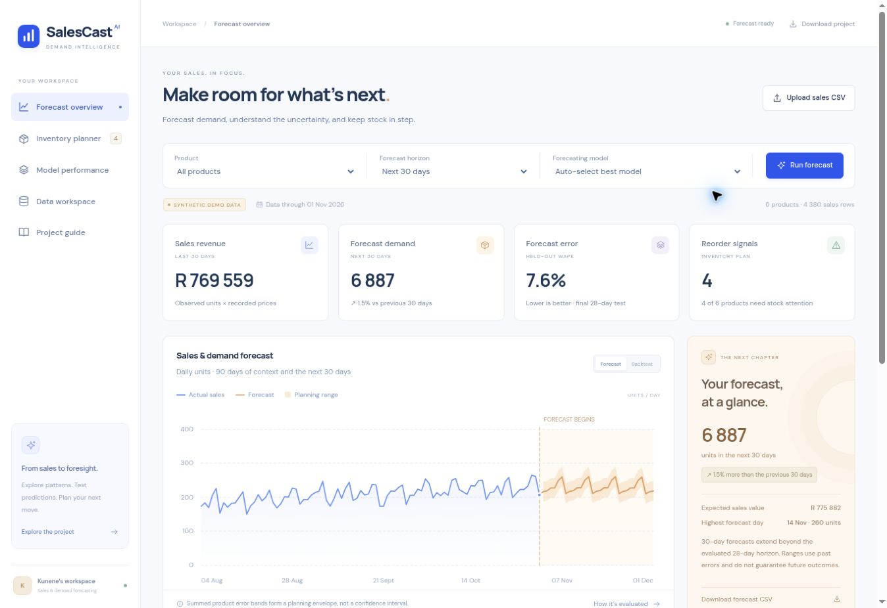

# Predict_Sale — SalesCast AI

A complete sales and demand forecasting project for Kunene: an interactive browser workspace, a reproducible Python pipeline, an executed Colab notebook, and inventory-planning calculations.

**[Open the live app](https://salescast-ai-kunene.bakedpivot2.chatgpt.site)** — sign in with ChatGPT if prompted.



## Run the app locally

```bash
python -m http.server 8000 --directory dist
```

Open http://localhost:8000. No API key, backend service, or Node dependencies are required to run the browser app. Serve over HTTP; opening index.html directly can block module workers. A modern browser with module-worker support is required. Optional Google Fonts fall back to system fonts.

## Use the workspace

1. Explore six synthetic products, choose a forecast horizon, and compare the forecast and backtest views.
2. Inspect Model performance for the final 28-day held-out errors and the weekly baseline.
3. Change available stock, supplier lead time, and safety-cover days in Inventory planner.
4. Upload daily sales through Data workspace. The model is trained in a browser worker; sales are not sent to a forecasting server.
5. Download daily forecasts and inventory estimates as CSV files.

Uploaded sales stay in memory for that browser session. Reloading restores the demo. Stock settings persist in local browser storage. The display currency selector changes labels without converting values.

## CSV format

```csv
date,product,units,unit_price
2026-01-01,Product A,24,129
2026-01-02,Product A,31,129
2026-01-03,Product A,0,129
```

This snippet illustrates the format; a valid import requires at least **140 continuous daily observations per product**, with all products ending on the same date. `unit_price` is optional. Dates must be YYYY-MM-DD. Units and prices must be non-negative. Duplicate product/date rows are summed; missing days are flagged and never automatically replaced with zero. Imports support up to 30,000 rows, 50 products, and 8 MB. Prices use the selected display currency; no conversion takes place.

Download `dist/data/demo_sales.csv` for a complete working example: 4,380 daily rows across six products, from 2 November 2024 to 1 November 2026. All sales, prices, stock levels, and lead times in the demo are invented.

## Models and evaluation

- **Calendar Ridge regression:** trend, weekday indicators, and annual Fourier terms when the initial training window includes a full year. L2 penalty alpha = 3; the intercept is unpenalised.
- **Weekly baseline:** repeat the final observed seven days.
- **Auto-selection:** compare absolute errors on two chronological 28-day validation windows. The final 28-day test is excluded from selection. Refit the selected model on all observations for future forecasts.
- **Planning ranges:** point forecast ± the 80th percentile of absolute validation errors, clipped at zero. Summed bounds are a planning envelope; they are not an 80% portfolio confidence interval.

Synthetic demo test WAPE: **7.6191%** for the selected models versus **11.4821%** for the weekly baseline. These are error rates on simulated sales, not accuracy guarantees for real businesses. Forecasts estimate observed sales and do not recover lost sales caused by stockouts.

## Reproduce the Python pipeline

```bash
pip install -r requirements.txt
python project/train_model.py
```

Or run all cells in `dist/SalesCast_Training_Kunene.ipynb` in Colab. The notebook includes its executed outputs and evaluation plots. It regenerates the demo CSV, catalog, evaluation JSON, and exported model-coefficient fixtures.

## Test the browser engine

```bash
npm test
```

The tests compare the browser and scikit-learn coefficients and predictions, verify that test targets cannot influence model selection or test predictions, validate CSV rejection/aggregation behavior, and verify inventory calculations and export counts. Node 18 or later is sufficient; no npm packages need to be installed.

## Project contents

| Path | Purpose |
| --- | --- |
| dist/index.html, style.css, app.js | Responsive user interface and interactive SVG charts |
| dist/engine.js | CSV parser, Ridge fitting, evaluation, portfolio totals, and stock planning |
| dist/worker.js | Fits and evaluates models away from the main UI thread |
| dist/data/demo_sales.csv | Complete, reproducible synthetic sales history |
| dist/data/catalog.json | Synthetic prices, stock, and supplier assumptions |
| dist/SalesCast_Training_Kunene.ipynb | Executed model-training notebook |
| project/train_model.py | NumPy/scikit-learn pipeline with fixed seed |
| project/evaluation.json | Independently recomputed test metrics |
| project/python_fixtures.json | Learned parameters and predictions for parity tests |
| project/test_engine.mjs | Meaningful data, modelling, and inventory tests |
| dist/PROJECT_REPORT.md | Methodology, assumptions, formulas, results, and limitations |

For a real business, include relevant promotions, stock availability, price changes, holidays, and distribution channels. Evaluate any extension on future time periods and against simple baselines before relying on it for ordering.

## Deploy to Hugging Face Spaces

Target: [Oageng/Predict_Sale](https://huggingface.co/spaces/Oageng/Predict_Sale).

The workflow `.github/workflows/deploy-huggingface.yml` validates the forecasting engine, prepares the static app, and publishes it on relevant changes to `main`. It can also be run manually from GitHub Actions.

Configure this one-time publisher in the Hugging Face Space's **Settings → Trusted Publishers**:

| Field | Value |
| --- | --- |
| Provider | GitHub Actions |
| Repository | `OagengKunene/Predict_Sale` |
| Branch | `main` |
| Workflow | `deploy-huggingface.yml` |
| Access | Publishing/write; leave Read-only unchecked |

The workflow exchanges GitHub's job identity for a short-lived token scoped to this Space. It does not require an account password or a stored `HF_TOKEN`. The publisher must be configured before the upload step can authenticate.

`project/prepare_huggingface.py` copies the contents of `dist/` to the Space root, adds the Space card from `huggingface/README.md`, and checks required assets. This preserves the browser worker, demo data, and download paths. The Space uses `sdk: static` and `app_file: index.html`.

To inspect the deployment files locally:

```bash
python project/prepare_huggingface.py --output /path/to/an/empty/output-directory
```

References: [Hugging Face Trusted Publishers](https://huggingface.co/docs/hub/trusted-publishers) and [Space configuration](https://huggingface.co/docs/hub/spaces-config-reference).
